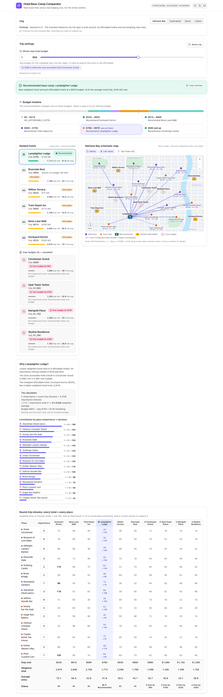
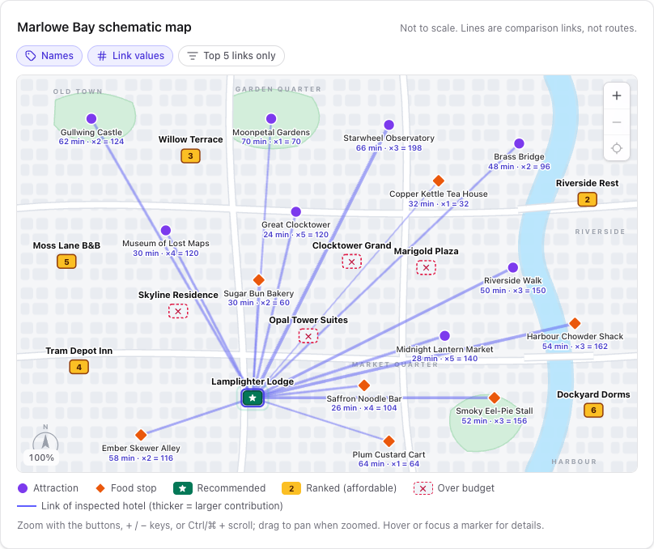

# Hotel Base-Camp Comparator

A local web app that helps pick a hotel "base camp". In each of four demo cities it ranks 10 hotels by how far they
are, on average and weighted by importance, from 15 wishlist places, all under **one whole-stay budget**. It
recommends the most accessible hotel you can afford, and explains why.

| City | Currency | Notes |
|---|---|---|
| **Marlowe Bay** | $ | The fictional reference city the spec is built around |
| **Hyderabad** | ₹ | Charminar, Golconda Fort, Hussain Sagar and more |
| **Kyoto** | ¥ | Fushimi Inari, Kiyomizu-dera, Arashiyama and more |
| **Lisbon** | € | Belém Tower, São Jorge Castle, Alfama and more |

In the three real-world cities the place names are real landmarks, but **the hotels, prices and travel times are invented and
approximate**. They are not real quotes or live traffic, and the app says so.

Built for the Cisco interview problem *SPR26_D2_P03*. Everything runs in the browser: no accounts, no network
calls, no external services.



## Quick start
```bash
npm install
npm run dev        # http://localhost:5173 — pick a city and press its Load button
```
Needs a current Node.js (developed and tested on Node 26).

| Command | What it does |
|---|---|
| `npm run dev` | Dev server |
| `npm test` | Vitest, run once (234 tests in 13 files); `npm run test:watch` to watch |
| `npm run lint` | Strict type-check (`tsc`) |
| `npm run build` | Type-check + production build |
| `python3 scripts/verify_expected.py` | Independent recomputation of the documented answers |

Run all four checks before finishing a change: `npm test && npm run lint && npm run build && python3 scripts/verify_expected.py`.

## How it decides
For each hotel and place: `contribution = importance × round-trip minutes`.
`weighted_travel_total` is the sum of contributions and is an exact integer. The **average** shown
(`total ÷ importance total`, one decimal, rounded half up with integer maths) is display only.

1. A hotel is **affordable** if `stay_cost <= budget`. Over-budget hotels read "Over budget by $X", get no rank and are never recommended.
2. Affordable hotels are ranked by exact total, then stay cost, then hotel ID (plain ASCII order).
3. If nothing is affordable the result is `NO_AFFORDABLE_HOTEL`: no winner, shortfalls shown.
4. Invalid input (budget, importance or structure) clears every rank, recommendation and link. There is never a partial ranking.

Marlowe Bay at budget $900: **Lamplighter Lodge** is recommended (total 1,712, 41.8 min average) even though
Dockyard Dorms is cheaper. Clocktower Grand is the most accessible overall but costs $980, so it is $80 over budget
and becomes the recommendation at exactly $980. Raising Riverside Walk's importance from 3 to 5 flips the winner
to Riverside Rest. Every city is built to show the same kind of story: a recommended hotel that is not the cheapest, and a more
accessible hotel that is just over budget.

## What you can do in the app
- **City:** pick a city on the landing screen, or switch with the City picker (arrow keys work). Switching loads that city's original trip.
- **Trip settings:** type or slide the whole-stay budget (in the city's currency); **Reset trip** restores the current city's original trip.
- **Budget timeline:** see which hotel is recommended at each budget range and jump to a range.
- **Ranked hotels:** click a card (or a map marker or table column) to inspect that hotel. Inspecting changes only the explanation and highlights, never the result.
- **Importance table:** edit any place's importance (1–5) and everything recalculates. The table also lists all 150 travel times.
- **Explanation panel:** the exact sum, remaining budget and each place's contribution for the inspected hotel.
- **Copy summary:** copy the recommendation and ranking as text.
- **Theme:** Light / Dark / System switcher in the header, remembered between visits.

### The map
A schematic city (not to scale; lines are comparison links, not routes).
- Zoom 100–400% with the + / − buttons, the `+` `−` `0` keys, or Ctrl/⌘ + scroll or pinch; drag to pan when zoomed.
- Hover or keyboard-focus a hotel or place for a details card.
- Layer toggles: **Names**, **Link values**, **Top 5 links only**.
- Zoom, pan and marker positions are presentation only and never affect results. Each city has its own backdrop (Hyderabad's lakes and Musi river, Kyoto's grid and Kamo river, Lisbon's Tagus). Demo-city layouts are schematic: some markers sit away from their true position so labels stay readable.



## Project layout
```
src/engine/      pure calculation, validation, ranking, budget timeline (no React, DOM, randomness or data imports)
src/data/        cities/ (registry + Marlowe Bay, Hyderabad, Kyoto, Lisbon: frozen constants); mainCity.ts + travelMatrix.ts (Marlowe Bay);
                 expected.ts (documented answers for all cities, tests/docs only)
src/state/       reducer (raw input strings), derive (view computed, never stored), useComparator, useTheme
src/components/  UI: CityPicker, Controls, StatusBanner, BudgetTimeline, HotelRanking, CityMap (+ backdrop, tooltip, viewport),
                 ExplanationPanel, TravelTable, ThemeSwitcher
scripts/         verify_expected.py — an independent second calculation path for every city
docs/            PLAN, DESIGN, EVIDENCE, PROMPTS, screenshots/, evidence/
```
`src/data/expected.ts` is imported only by tests; a test fails if app or engine code imports it. The Python script
cross-checks it using only the raw matrix numbers.

## Adding a city
1. Create `src/data/cities/<id>.ts` (10 hotels, 15 places, a 10×15 constant matrix, markers, a `BackdropSpec`) using `buildCity`, and register it in `src/data/cities/index.ts`.
2. Document its answers in `src/data/expected.ts` (`EXPECTED_CITIES`).
3. `npm test` (cities tests check shape, story conditions, label layout and parity) and `python3 scripts/verify_expected.py` must both pass.

## Documentation
- [docs/PLAN.md](docs/PLAN.md) — the staged plan and later enhancements
- [docs/DESIGN.md](docs/DESIGN.md) — architecture, formulas, state, visual system, motion, map, trade-offs
- [docs/EVIDENCE.md](docs/EVIDENCE.md) — test results, requirement-to-test map, edge cases, screenshots, accessibility audit
- [docs/PROMPTS.md](docs/PROMPTS.md) — the prompts used and what each produced
- [CLAUDE.md](CLAUDE.md) — project memory and non-negotiable invariants for Claude Code

## Accessibility
State is never colour-only (★ Recommended, rank numbers, ✕ + "Over budget by $X"); controls are keyboard operable;
the table is the accessible equivalent of the map; `prefers-reduced-motion` is respected. axe-core runs in the test
suite. Known limits: contrast was computed by script rather than measured in a browser, and no screen-reader run was done.

## Stack
React 19 · Vite · TypeScript (strict) · Tailwind CSS v4 · lucide-react · Vitest + Testing Library + axe-core.
